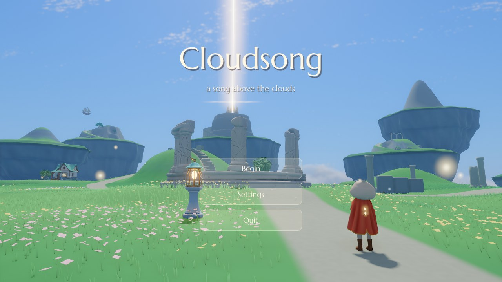
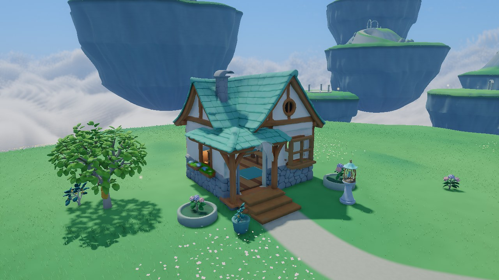
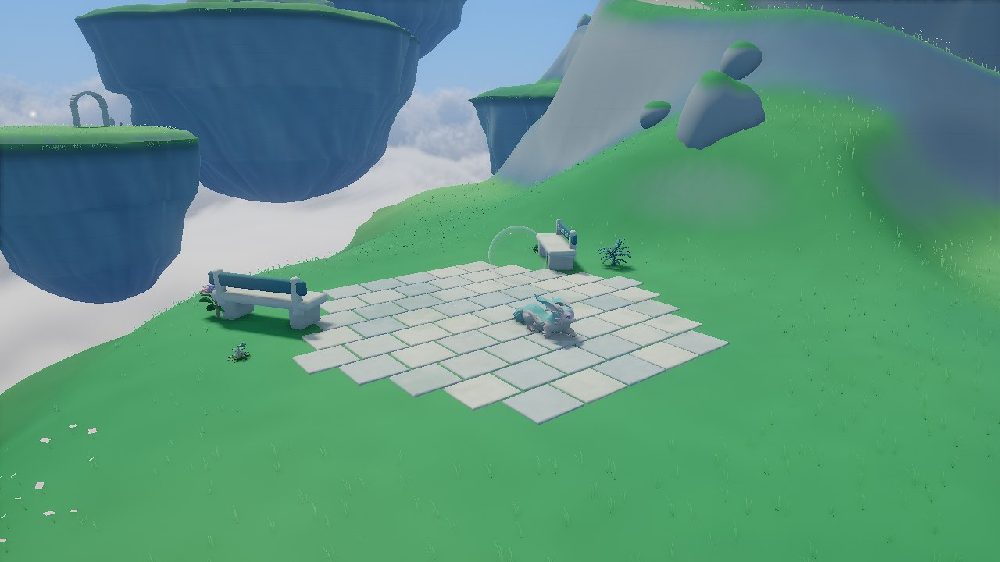
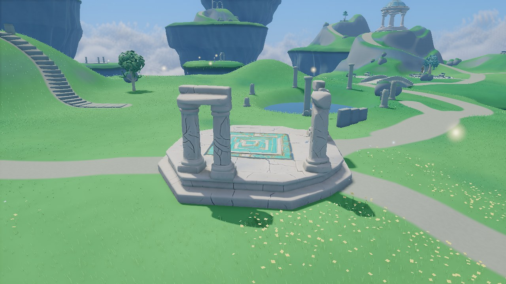
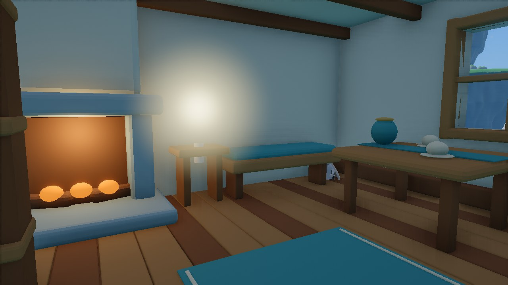

# Cloudsong

A calm exploration game on the [Quench](https://github.com/m-brtn/Quench) engine: a small hooded figure with a long
cape on grassy isles that float above a sea of clouds. Walk, run, jump, glide and fly between the
isles, gather drifting lights, light the old candles, wake the sleeping spirits and bring them to the temple of light.
A short journey of about ten to fifteen minutes.



| | |
|---|---|
|  |  |
|  |  |

The player, animals, garden trees and landmark buildings are original AI-generated models from Hyper3D.
The game animates the characters and clothing, shapes the islands and paths, and adds plants, light, music and sound.
Artwork and font sources are in `CREDITS.md`.

## The journey

Start on the meadow. Drifting lights hang over the isles: gathering them adds marks to the cape, and each lit mark
is one flap in the air. The marks fill again on the ground near warm light (the lanterns, the lit candles). Three
cold candles stand by three sleeping spirits: by the pond, inside the cottage and on an isle across the clouds. Call
beside a candle to light it; its spirit wakes and follows. A call anywhere also shows the way: a few small lights
rise beside the figure and fly to the nearest cold candle (later to the rising air, then to the altar), circle it
for a moment and fade. With every candle lit, rising air opens on the isle of the broken columns and carries the
player up to the temple of light. Stand at its altar with the spirits.

Golden wind chimes are hidden off the paths, in quiet corners and in the higher gardens. Gather three to awaken the wind song:
call while gliding for a brief forward gust and a little lift. It recharges in five seconds; the small gold line
below the chime counter shows when it is ready. There are twelve chimes to discover. These are separate from
the drifting lights that add flight energy.

Explore the furnished cottage, the harp keeper’s court, the observatory and a fossil cave lit by turquoise
fireflies. A small creature lives on a meadow terrace: it approaches curious visitors, then returns to its
own wanderings. Two soap bubbles can be nudged and bounced around the terrace.

The starting pond holds a small stationary sailboat. Walking into the pond gently lifts the player above the
water, with arms spread and one leg tucked. Return to the shore to settle back onto the ground, or jump to take flight.

## Controls

| | Keyboard and mouse | Gamepad | Touch (iPhone) |
|---|---|---|---|
| Move | WASD or the arrow keys | left stick | left thumb, anywhere on the left |
| Walk slowly | Left Shift | push the stick a little | a short push |
| Camera | drag with the mouse, or J L I K | right stick | right thumb |
| Jump; in the air: flap (uses a mark), hold: glide | Space | A (south) | the arrow button |
| Call (guide, nearby candle; wind song while gliding) | E | X (west) | the rings button |
| Rest (pause, settings) | Escape | Start (Menu) | the pause button |

Settings (on the title and when resting): picture quality (Light, Balanced, Beautiful), motion blur, colour boost,
music and sound volume, camera speed, inverted camera, and time of day. The day/night cycle starts frozen at 11:30; enable it to let the
sun move, choose a full day of 1–60 minutes, or use Morning / Noon / Evening to compare the lighting. Resting
pauses the cycle. The settings list scrolls between a fixed header and Back button. Preferences are kept in the
user directory (`settings.json`). Phones start at Balanced and
60 Hz with a lower render scale, and lower it further when they grow hot.

Motion blur starts at a gentle 25% and follows camera movement, leaving the interface sharp. Colour boost starts
at 12% for slightly richer greens and sky while keeping neutral whites. Both can be set to zero in Settings.

## Build

Requirements: CMake 3.28+, Ninja, Xcode with the Metal toolchain. The first configure downloads the engine (pinned in
`CMakeLists.txt`) and its dependencies.

```sh
cmake --preset release
cmake --build --preset release
ctest --preset release
build/release/cloudsong
tools/package.sh        # dist/: macOS app/zip; --ios also makes a signed iOS app and IPA
```

Engine flags (`--help` lists them all): `--quit-after S`, `--capture FILE`, `--script FILE`, `--frame-size WxH`,
`--gpu-backend metal|sdl`, `--no-audio`. Automated runs (`--script`, `--capture`, `--quit-after`) are offscreen.

## Layout

```
src/Game.cpp        the game: screens, camera, light, weather, input, the end, scenario commands
src/Front.*         the title, the pause menu and its settings, the controls' hint, the touch controls
src/Settings.*      the player's settings (settings.json)
src/World.*         the isles, grass and flowers, ruins, the cave, the temple, pond, candles (meshes, physics,
                    the navmesh's geometry)
src/Region.cpp      graded routes, bridge approaches, foundations, sanctuary and garden architecture
src/Places.cpp      the cottage steps and garden, cave walls, stone threshold and stalactites
src/MeadowLife.*    the curious resident, violet eye trails and two pushable soap bubbles
src/Bird.*          the user-selected skeletal bird in the cottage cage
src/Hero.*          the imported player: locomotion, foot placement, cloth, energy marks and trail anchors
src/Character.*     the procedural figures: skinned mesh, gaits, foot and head IK, the cape's cloth
src/Player.*        the player's movement on Jolt's virtual character: run, jump, glide, flap, updrafts
src/Journey.*       the drifting lights, the candles, the energy
src/Spirits.*       the spirits: asleep, waking, following on the navmesh or through the air, gathered
src/Sound.*         the score and the sounds, synthesized; the wind through the engine's weather sounds
src/Glow.*          an additive pass for beams, rings of light, motes and halos
shaders/            surfaces (ground, stone, figures; grass and flowers in the wind) and the glow
scenarios/          scripted checks (--script), run by ctest; views.txt captures the key views, perf.txt measures
                    frame and GPU times per picture setting
docs/images/        the screenshots above
tests/golden/       reference captures for the golden image checks
tools/package.sh    the macOS and iOS packages
devlog/             development log
```

The region now opens into seventeen floating isles: winding meadow paths, arched bridges, a sky sanctuary,
bell gardens and roofless arcades. The western bridge leads to the sanctuary; higher gardens invite a flight
above the clouds. A secluded northern meadow reveals pale cyan flowers at night.
